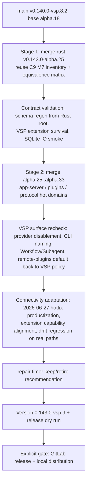

# Codex-VSP C10 Full Upstream Merge And Client Connectivity Architecture

## Scope

This architecture baseline covers C10: a two-stage FULL merge of the VSP fork onto upstream `rust-v0.143.0-alpha.33` (Stage 1: `rust-v0.143.0-alpha.25`, Stage 2: `alpha.25..alpha.33`), followed by client connectivity adaptation (VSCode Plugin, Codex Desktop, Remote APP) and a new public series `0.143.0-vsp.9`. The real pre-C10 merge base is `rust-v0.140.0-alpha.18`; C9's alpha.25 work was equivalence convergence, not a merge. VSP behavior remains the compatibility contract for preserve-boundary surfaces; upstream behavior is adopted everywhere else.

## Architecture Flow

## Conflict Domains

| Domain | Default Direction | Notes |
| --- | --- | --- |
| SQLite persistent logging | Adopt upstream fixes, keep VSP in-layer `target=="log"` guard | Validated by runtime SQLite/WAL growth evidence, not only static tests. |
| App-server protocol and schemas | Reconcile from contract root | Rust protocol is source of truth; JSON/TS schemas, app-server, and clients stay in lockstep; regeneration is mandatory after merges. |
| Core workflow runtime | Preserve VSP unless official equivalent is proven | Hypo-Workflow routing, plan freshness, goals, worker separation, tool gates. |
| Plugins | Upstream code, VSP policy | Upstream enables remote plugins by default; VSP disabled-remote policy wins, enforced by tests. |
| Multi-agent v2 / Rendezvous WebSocket | Follow upstream internally | Not exposed as VSP-committed capabilities; voice/realtime and remote-control remain non-user-facing. |
| TUI user surfaces | Preserve VSP unless official equivalent is proven | Question Tool cards, plan panel, provider UX, workflow slash routing. |
| CLI, VSCode, updater, release | Preserve VSP identity | `vsp-codex` naming, VSCode repair self-heal, socket remap, CODEX_HOME-pinning wrappers, manifest updater, GitLab release path. |
| Client connectivity contract | VSP-owned | Launch path, home, and socket namespace must all resolve to VSP; every known drift vector has versioned self-heal + real-path regression. |

## Validation Baseline

- Hygiene: `cargo fmt --all --check`, `git diff --check`, no conflict markers.
- Focused Rust suites: codex-core workflow_routing, codex-app-server(-protocol) request_user_input / workflow_markdown_surface, codex-core-plugins, codex-tui workflow_slash_routing, codex-cli vscode / vsp_entrypoint, codex-state filter.
- SQLite IO smoke with isolated homes; zero noisy-target rows.
- Drift regression scenarios on real shims/wrappers/sockets; mock-only tests are rejected by audit.
- Real client acceptance on this machine (VSCode Remote Plugin, Desktop/Remote APP).
- Release: dry run first; no push/tag/upload/release until the explicit user gate. Full workspace suite is historically red on this host (libcap.pc, integration timeouts) and is not a release gate; release notes must not overclaim.

## Fallback Contract

On uncontrollable merge conflicts (upstream refactor breaking core Workflow runtime or preserve-boundary surfaces), execution STOPS and reports options via Question Tool. No silent downgrade to equivalence convergence, no unauthorized scope changes.
