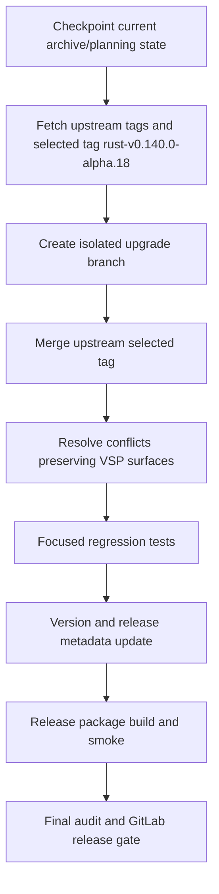

# C9 Upstream Base Upgrade And Deep Research Brief

创建时间：2026-06-14T09:08:51+08:00

## 目标

C9 主交付是把 VSP-Codex 从当前 `0.134.0-vsp.7.2` 基线升级到上游 Codex `rust-v0.140.0-alpha.18`，完成冲突处理、VSP 定制保留、验证、版本元数据更新和 GitLab release 发布。

C9 次交付是为 Deep Research 生成可迁移到 Hypo-Workflow 的需求简报，不在本 Cycle 做 Codex-VSP 原型或生产实现。

## 架构保护面

上游基线升级必须保护以下 VSP 定制面：

- VSP CLI / binary identity：`vsp-codex` 命令入口、版本字符串和 release 包布局。
- VSP provider 与配置：`~/.vsp-codex`、provider 初始化、OpenAI-compatible provider、provider cache/session 兼容。
- VSCode / Remote SSH 接入：`vsp-codex vscode install/status/rollback`、Remote SSH server Machine settings 优先级、官方插件 resume 兼容。
- Workflow runtime surface：`.pipeline` 项目 runtime guidance、`/hw:*` routing helper、`request_user_input` Workflow metadata、Workflow Markdown surface、Plan/SubPlan freshness。
- Subagent UX：内置 Subagent 命名、active Subagent panel、Prompt/Report viewer、worker separation 约定。
- VSP release channel：`scripts/build_vsp_preview_release.py`、`.pipeline/release/vsp-release-manifest.json`、README/docs install 命令、GitLab Release asset URL。
- 本地安装与 updater：`scripts/install/install.sh` 对官方 release 与 VSP archive-url/manifest 模式的兼容。

## 升级接入点



## Deep Research 需求简报

Deep Research 的可移植需求如下：

- 必须先使用 Question Tool 澄清用户需求，不能直接进入调研。
- 支持多个 Subagent 并行调研，并保留每个 Subagent 的原始报告。
- 支持递归探索：发现 A 后可以继续基于 A 展开后续研究。
- 支持预算与剪枝：候选默认最大深度 10、Subagent 上限 128，但必须有预算上限、重要性阈值/剪枝比例和停止条件。
- 需要进度面板的手动控制：查看、暂停/停止、选择分支深入。
- 支持 follow-up 和继续深入研究。
- 默认产物写入 `.pipeline/research/<slug>/`；允许调用者指定其他输出根目录，例如 Writer 项目目录。
- 报告必须可读、完整、详细；原始报告、进度状态和最终报告应分开保存。
- 验证场景允许真实联网：调研“当前大模型市场最新模型、性能和定价”，需要来源证据。

建议 Hypo-Workflow 负责 portable command semantics 与 artifact contract；Codex-VSP 或其他平台负责具体 Subagent 调度、UI 面板和执行能力。

## 建议产物布局

```text
.pipeline/research/<slug>/
  brief.yaml
  progress.yaml
  graph.yaml
  raw/
    <agent-id>-prompt.md
    <agent-id>-report.md
  sources.yaml
  report.md
  followups/
    <timestamp>-question.md
    <timestamp>-report.md
```

自定义输出路径应替代 `<research-root>`，即完整产物目录写入用户指定根目录下，而不是只改最终报告路径。

## 验证策略

上游基线升级：

- 先做 focused tests 覆盖 Workflow、Request Input、VSCode、provider/session/release 保护面。
- 再做 format、workspace/broad tests、release build、package smoke 和 `git diff --check`。
- GitLab push/tag/release 必须作为单独执行门禁。

Deep Research 简报：

- 验证产物是简报本身：内容覆盖 Question Tool、Subagent fan-out、递归、预算/剪枝、进度控制、follow-up、产物布局和真实联网验证场景。
- 不把本 Cycle 伪装成已实现 Deep Research。

## 风险

- `0.134.0` 到 `0.140.0-alpha.18` 是跨多版本 alpha 升级，可能带来协议、crate、release 包、Node/Bazel 和 app-server schema 冲突。
- 当前工作区已有归档整理和既有未提交改动；升级前必须先提交或检查点，避免 merge diff 无法审计。
- 发布 GitLab release 是外部副作用，执行期必须硬确认。
- Deep Research 只做简报，后续真正实现应进入 Hypo-Workflow 或后续 VSP Cycle。
