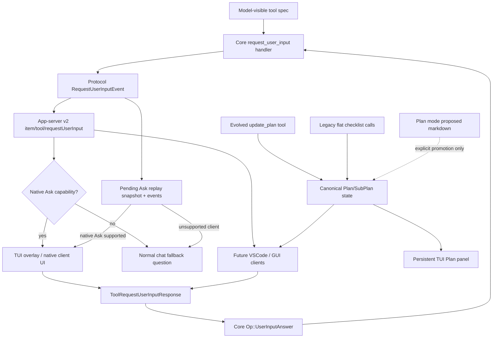

# Ask User Tools 与 Plan 常驻窗口架构草图

## 核心判断

Ask User Tools 应当以现有 `request_user_input` 为基础演进。当前仓库已经具备 core handler、protocol 类型、app-server v2 实验性 RPC、TUI overlay 和 history cell，因此 C3 的关键不是“新增一个问答工具”，而是把它升级为跨客户端可恢复、可降级、可审计的结构化协作能力。

C3 不把 app-server Ask API 一次性宣布稳定。现有 `item/tool/requestUserInput` 已是实验性 RPC，而 C3 会改变题型、答案结构、resume 和 fallback 语义；因此本 Cycle 继续扩展 experimental payload，并等至少一个非 TUI 客户端路径真实消费后再考虑稳定化。

Plan 常驻窗口则是第二条一等主线。当前仓库有 `update_plan` flat checklist、Plan mode proposed-plan markdown stream 和 plan history cell，但这些都不是“输入框上方右侧常驻、支持 SubPlan、由 LLM 结构化填写”的状态模型。C3 需要改造现有 `update_plan`，保留 flat checklist 兼容层，同时新增结构化 Plan/SubPlan state，并由 TUI 常驻面板消费。

## 组件关系



## 当前已有能力

- Core：`RequestUserInputHandler` 已能发起问题并等待用户回答。
- Protocol：`RequestUserInputQuestion`、`RequestUserInputResponse` 等类型已存在。
- App-server：`item/tool/requestUserInput` 已存在但标记为 experimental；C3 继续保持 experimental，并扩展其 payload。
- TUI：`bottom_pane/request_user_input` 已有 overlay，支持选项、notes/freeform、多问题、队列、未答确认和 snapshot。
- Replay：TUI 已有 `pending_interactive_replay` 路径，但 C3 必须验证它能处理跨设备 resume 下的 pending Ask，并在不支持 native Ask UI 的客户端降级。
- Plan：`update_plan` 已有 flat checklist 工具，但不允许在 Plan mode 使用。
- Plan mode：proposed plan 通过 assistant markdown stream 抽取为 PlanItem/PlanDelta。
- Plan UI：当前是 history cell，不是常驻面板。

## 需要设计的新增能力

- 显式题型：single_choice、multi_choice、short_answer/free_text、order-only ranking；confirmation 可由 single_choice 表达，后续如有必要再独立成快捷类型。
- 结构化答案：区分选项 id、label、自由文本、排序顺序和 secret redaction。
- 跨客户端语义：让 TUI/VSCode/GUI 都能基于同一 v2 payload 渲染。
- 隐私策略：secret 输入如何显示、返回、持久化、记录到历史。
- 模型行为边界：root agent 的普通交互 turn 可以问用户，包括默认 bypass；subagent 不直接弹 Ask；无人值守或 UI-less 场景必须 fallback 或显式失败，不能永久等待。
- 结构化 Plan/SubPlan：明确 root plan、subplan、item id、status、summary、当前焦点；每个 root item/Milestone 下先支持一层 SubPlan。
- 常驻 Plan 面板：宽屏右侧、窄屏折叠、不会挤压 composer；平时显示，Default idle 时折叠为一行“当前 root item / 当前 SubPlan / completed-total 进度”。
- 跨客户端 Plan state：未来 VSCode/GUI 不应解析 TUI history cell。
- 跨设备 pending Ask：换电脑 resume 后，支持 Ask UI 的客户端应重新弹框；不支持 Ask UI 的客户端应把问题转成普通编号聊天，而不是卡住。native Ask 支持必须是独立 client capability，不能只看 `experimentalApi`。

## 初步推荐路线

第一阶段不要扩大成通用表单引擎。C3 的最小闭环建议是：把 `request_user_input` 的题型与答案协议做成实验性但清晰的跨客户端契约，TUI 支持 single_choice、multi_choice、free_text、order-only ranking 四类，并把 secret/history 行为做扎实；复杂条件显示、文件上传、动态校验、ranking per-item notes 等留到后续 Cycle。

Plan 主线的最小闭环建议是：改造现有 `update_plan` 为结构化 Plan/SubPlan 工具接口，由 LLM 主动更新 root plan 和一层 SubPlan；TUI 使用独立模块在输入框上方右侧显示当前 plan，窄屏和 Default idle 折叠为一行摘要；旧 flat checklist 调用继续兼容，但新的常驻面板以结构化 state 为准。

## Fallback 普通聊天模板

当 resumed client 不支持 native Ask UI 时，系统生成普通 assistant 消息：

```text
我需要你回答几个问题后继续。当前客户端不支持原生 Ask UI，请按编号回复：

1. [short_answer] 你的问题文本
2. [single_choice] 请选择一个：
   A. 选项 label - description
   B. 选项 label - description
3. [ranking] 请按优先级排序：A, B, C

请用类似下面格式回答：
1. ...
2. A
3. B, A, C
```

内部必须保留 `call_id`、`turn_id`、question ids、question kinds、option ids 和 fallback option letter 到 option id 的映射。能解析用户回复时，将其转成结构化 Ask answer；不能解析时，由 LLM 追问澄清，而不是继续等待不可用 UI。
