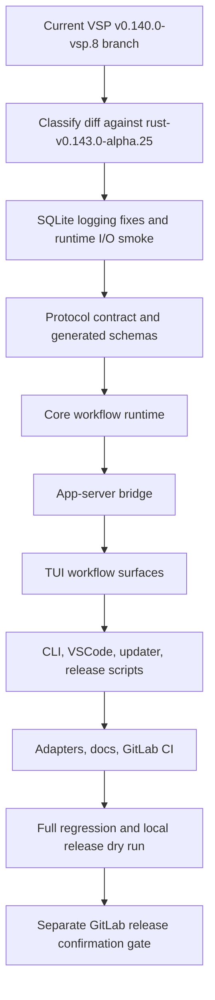

# Codex-VSP C9 Alpha.25 Upstream Sync Architecture

## Scope

This architecture baseline covers the appended C9 plan for syncing Codex-VSP toward upstream `rust-v0.143.0-alpha.25` while preserving the VSP public version series `0.140.0-vsp.8`. The fork should prefer official alpha.25 behavior only when it is equivalent to the VSP behavior being replaced. Otherwise, VSP behavior remains the compatibility contract.

The plan is append-only for the existing C9 Cycle. Existing prompts `c9-001` through `c9-006` remain historical execution artifacts. New generated prompts start at `c9-007`.

## Architecture Flow

## Conflict Domains

| Domain | Default Direction | Notes |
| --- | --- | --- |
| SQLite persistent logging | Prefer upstream fix plus keep VSP guard if needed | Must be validated by runtime SQLite/WAL growth evidence, not only static tests. |
| App-server protocol and schemas | Reconcile from contract root | Source protocol, JSON schema, TypeScript schema, app-server, and clients must stay in lockstep. |
| Core workflow runtime | Preserve VSP unless official equivalent is proven | Covers Hypo-Workflow routing, plan freshness, goals, worker separation, multi-agent, and tool gates. |
| App-server bridge | Adapt to upstream structure while preserving VSP behavior | Request processors may move upstream, but Question Tool and workflow markdown semantics remain required. |
| TUI user surfaces | Preserve VSP unless official equivalent is proven | Includes Question Tool cards, plan panel, status/footer surfaces, provider UX, snapshots, and workflow slash routing. |
| CLI, VSCode, updater, release | Preserve VSP identity | `vsp-codex`, VSCode/Remote integration, update manifest, package builder, and GitLab release dry run are fork surfaces. |
| OpenCode/Hypo adapters | Preserve VSP integration | Adapter changes should track runtime behavior and generated command surfaces. |

## Validation Baseline

The release-preparation floor is broad local regression plus local release dry run plus SQLite runtime I/O smoke.

Required validation families:

- Hygiene: `cargo fmt --manifest-path codex-rs/Cargo.toml --all -- --check`, `pnpm format`, `python3 scripts/check_ci_docs.py`, and `git diff --check`.
- Targeted Rust checks: `codex-state`, `codex-app-server`, `codex-app-server-protocol`, `codex-core`, `codex-cli`, and `codex-tui` focused tests/checks.
- SQLite I/O smoke: isolated `CODEX_HOME` and `CODEX_SQLITE_HOME`, real binary/app-server/TUI path, before/after `logs_2.sqlite` and `logs_2.sqlite-wal` size measurements, and persisted target-count checks for `log`, `codex_otel.log_only`, and `codex_otel.trace_safe`.
- Release dry run: release build of `vsp-codex`, `scripts/build_vsp_preview_release.py`, sha256 verification, manifest JSON validation, and release notes review.

No GitLab tag, push, upload, or release mutation is allowed until a separate release confirmation gate.
