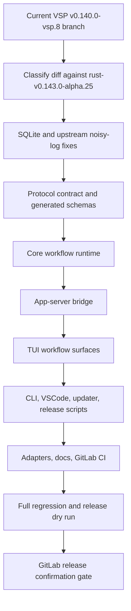

# C9 Upstream Alpha.25 Architecture Checkpoint

## Stage Summary

This architecture checkpoint treats the work as an incremental, conflict-group upstream sync from the current VSP branch toward `rust-v0.143.0-alpha.25`. The current diff is too large for a single merge pass: roughly 523 non-pipeline files differ from the target, with the largest surfaces in TUI, core workflow runtime, app-server protocol/app-server, CLI, and OpenCode/Hypo-Workflow adapters.

The existing `.pipeline/architecture.md` was not readable during this checkpoint, so this proposal should act as the temporary architecture baseline for Decompose. If confirmed, Generate can either keep it as `.plan-state` evidence or promote a concise version into `.pipeline/architecture.md`.

## Architecture Flow

## Conflict Domains

| Domain | Approx. changed files | Default action | Why |
| --- | ---: | --- | --- |
| TUI workflow surfaces | 250 | Preserve VSP unless upstream equivalent is proven | This is the largest user-visible surface: cards, plan panel, status surfaces, provider UX, snapshots. |
| Core workflow runtime | 60 | Preserve VSP | Hypo-Workflow routing, plan freshness, goals, and worker separation are VSP-specific unless alpha.25 has direct equivalents. |
| App-server protocol | 30 | Reconcile carefully | Official alpha.25 adds/removes/renames many schema and TypeScript artifacts; blind overwrite can break Ask/Question Tool clients. |
| App-server bridge | 33 | Adapt to upstream structure while preserving VSP behavior | Request processors changed upstream, while VSP needs Question Tool and workflow markdown behavior. |
| CLI / VSCode / updater | 29 | Preserve VSP | `vsp-codex`, VSCode/Remote integration, VSP updater, and release paths are fork identity surfaces. |
| OpenCode/Hypo adapters | 20 | Preserve VSP | These are integration assets, not likely to be replaced by official Codex directly. |
| SQLite logging | 4 | Prefer upstream fix plus keep VSP guard if needed | Small code surface, high disk-lifetime risk; must be validated at runtime. |
| Release scripts/docs/CI | 22 | Preserve VSP release toolchain | GitLab release and `0.140.0-vsp.8` series policy are local fork requirements. |

## Key Decisions

| Decision | Proposed Architecture |
| --- | --- |
| Merge strategy | Incremental merge by conflict domain, not a single full merge. |
| Official versus VSP behavior | Prefer official alpha.25 only when behavior is equivalent; otherwise preserve VSP. |
| Ordering | SQLite fix first, then protocol, core, app-server, TUI, CLI/release, adapters/docs/CI, final release dry run. |
| SQLite validation | Static tests are not enough; Architecture requires a bounded runtime I/O smoke with isolated `CODEX_HOME` and `CODEX_SQLITE_HOME`. |
| Version surface | Keep the `0.140.0-vsp.8` series; `0.140.0-vsp.8.1` remains allowed but needs final release confirmation. |
| Remote release | Architecture ends at prepared local artifacts; GitLab release update remains a later confirmation gate. |

## Runtime I/O Validation Shape

The SQLite smoke should run VSP Codex in an isolated home, capture `logs_2.sqlite` and `logs_2.sqlite-wal` sizes before and after a bounded TUI/app-server scenario, and query persisted log targets. It must reject a pass if `log`, `codex_otel.log_only`, or `codex_otel.trace_safe` continue to be persisted, or if database/WAL growth is sustained beyond the threshold defined in Decompose.

## Risks And Open Questions

- Protocol generated schema churn can silently break app-server clients if app-server protocol, TypeScript schema, app-server tests, and TUI clients are not kept in lockstep.
- TUI snapshot churn is high; it should happen after protocol/core convergence to avoid repeated conflict resolution.
- Publicly staying in the vsp.8 series while changing upstream base can confuse diagnostics unless release notes or manifests record the alpha.25 base.
- Exact SQLite byte-growth threshold and scenario duration remain open for Decompose.
- Final public tag remains open: strict `v0.140.0-vsp.8` versus `v0.140.0-vsp.8.1`.
