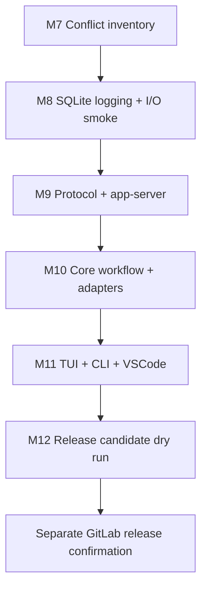

# C9 Alpha.25 Sync Decompose Checkpoint

## Summary

This Decompose proposal appends six serial Milestones to the existing C9 Cycle. Existing prompt files `c9-001` through `c9-006` are preserved; generated execution prompts, if confirmed later, should start at `c9-007`.

The plan follows the confirmed architecture order: conflict inventory, SQLite logging, protocol/app-server, core/adapters, TUI/CLI user surfaces, then release candidate dry run. The intent is to sync toward `rust-v0.143.0-alpha.25` while preserving VSP behavior unless alpha.25 has a proven equivalent.

## Milestone Split

| Milestone | Name | Purpose | Primary Validation |
| --- | --- | --- | --- |
| M7 / c9-007 | Conflict Inventory And Upstream Fix Baseline | Classify alpha.25 conflicts and official equivalence candidates before broad code changes. | Conflict/equivalence reports with no unassigned high-risk domain. |
| M8 / c9-008 | SQLite Logging Convergence And Runtime I/O Smoke | Converge logging filters and add real SQLite/WAL growth evidence. | `codex-state` filter tests plus isolated runtime I/O smoke. |
| M9 / c9-009 | Protocol Contract And App-Server Bridge Merge | Reconcile schema/protocol churn while preserving Question Tool and workflow app-server behavior. | Schema generation, protocol tests, app-server request_user_input/workflow tests. |
| M10 / c9-010 | Core Workflow Runtime And Adapter Preservation | Merge core changes while preserving Hypo-Workflow, worker separation, plugins, and adapters. | Core workflow routing, plan gate, request_user_input, and plugin tests. |
| M11 / c9-011 | TUI CLI VSCode And User Surface Convergence | Reconcile user-facing TUI/CLI changes and preserve VSP provider, cards, plan panel, VSCode/Remote. | Focused TUI/CLI tests plus broad TUI regression where practical. |
| M12 / c9-012 | Release Candidate Dry Run And GitLab Release Preparation | Prepare local RC artifacts and stop before remote publication. | Broad regression, release build/package, manifest/sha checks, SQLite I/O evidence. |

## Technical Route

## M7: Conflict Inventory And Upstream Fix Baseline

Objective: create a concrete conflict and equivalence matrix for alpha.25 before broad merge resolution.

Technical solution: use read-only git evidence to classify all major conflict domains and preserve VSP by default until official equivalence is proven.

Technical route: compare current branch against `rust-v0.143.0-alpha.25`; map SQLite fix commits; classify VSP surfaces as replace, preserve, or defer; write reports under `.pipeline/reports/C9/`.

Research status: resolved by local evidence. The target tags and conflict domains have already been observed during Plan.

Risks and alternatives: a fresh-upstream reapply was rejected because the VSP change surface is too large. The risk is stale evidence if upstream moves, so this milestone pins alpha.25.

Validation path: diff/status reports must assign every major conflict domain and cite evidence for each official replacement claim. Test owns validation; audit checks no broad product code changed during inventory.

## M8: SQLite Logging Convergence And Runtime I/O Smoke

Objective: prevent persistent SQLite log write amplification from recurring.

Technical solution: enforce filtering at both the unit-testable log filter boundary and the actual SQLite sink/runtime boundary.

Technical route: compare the local hotfix with alpha.25 logging; keep the stronger filter behavior; add or refine an isolated `CODEX_HOME`/`CODEX_SQLITE_HOME` smoke that measures `logs_2.sqlite` and WAL size before/after and queries noisy target counts.

Research status: proposed resolution. Decompose confirmation accepts a bounded-growth/noisy-target rejection contract, with implementation allowed to make the byte threshold stricter once the smoke command is concrete.

Validation path: `cargo test --manifest-path codex-rs/Cargo.toml -p codex-state filter -- --nocapture`, focused checks for state/app-server/TUI, and a real runtime I/O smoke. Audit rejects static-only evidence.

## M9: Protocol Contract And App-Server Bridge Merge

Objective: merge protocol and app-server changes without breaking VSP Question Tool or workflow clients.

Technical solution: treat `codex-rs/app-server-protocol` as the contract root, regenerate derived schema artifacts, then update app-server bridge code and tests.

Technical route: compare alpha.25 schema/type changes; decide official replacement versus VSP preservation for Ask/Question and plan update events; regenerate fixtures; update app-server tests.

Research status: resolved by local code plus deferred implementation checks. Generated schemas and exact app-server tests must run after conflict resolution.

Validation path: schema fixture generation, protocol package tests, and app-server request_user_input/workflow markdown tests. Audit checks generated artifacts match source definitions.

## M10: Core Workflow Runtime And Adapter Preservation

Objective: preserve Hypo-Workflow runtime contracts while accepting compatible upstream core refactors.

Technical solution: use core runtime behavior as the semantic boundary: workflow routing, plan freshness, goals, worker separation, multi-agent, and plugins must remain intact.

Technical route: merge core by package; run workflow routing and tool spec tests; update adapters only when runtime behavior changes; document any official equivalent that allows VSP code deletion.

Research status: resolved by existing project config and Architecture. Strict worker separation and start/resume subworker authorization already exist.

Validation path: focused `codex-core` workflow/plan/request_user_input tests and `codex-core-plugins` tests. Audit checks worker separation is not downgraded.

## M11: TUI CLI VSCode And User Surface Convergence

Objective: preserve user-visible VSP behavior while merging alpha.25 TUI/CLI changes.

Technical solution: merge TUI only after protocol/core/app-server stabilize; treat snapshots as semantic evidence, not mechanical churn.

Technical route: reconcile request_user_input cards, plan panel, status/footer, provider setup, workflow slash routing, CLI entrypoint, VSCode install/status/rollback, and updater behavior.

Research status: resolved by Architecture ordering and existing C9 preservation policy.

Validation path: focused TUI workflow/request_user_input tests, CLI VSCode tests, and broad TUI nextest where practical. Audit reviews snapshot changes for real UI semantics.

## M12: Release Candidate Dry Run And GitLab Release Preparation

Objective: produce a local release candidate and release evidence, then stop before any GitLab mutation.

Technical solution: use existing VSP preview release builder and manifest format, with final version string confirmed at the start of M12.

Technical route: confirm `v0.140.0-vsp.8` versus `v0.140.0-vsp.8.1`; run hygiene, broad regression, SQLite smoke, release build, package builder, sha256, manifest JSON validation, docs checks, and release notes preparation.

Research status: final version is deferred by user to M12 pre-release confirmation. Remote GitLab publication is explicitly outside this plan until a later release gate.

Validation path: broad regression plus release dry run and manifest checks. Audit verifies no tag, push, upload, or GitLab release mutation occurred.

## Open Assumptions For Confirmation

- Decompose confirmation accepts the SQLite smoke threshold as qualitative bounded-growth plus strict noisy-target rejection; implementation may tighten it to a numeric byte/sample threshold.
- Final release version remains deferred to M12: either strict `v0.140.0-vsp.8` or `v0.140.0-vsp.8.1`.
- Generate should append prompts `c9-007` through `c9-012` and include `test`, `implement`, and `audit` subworker assignment plans in each implementation prompt.
